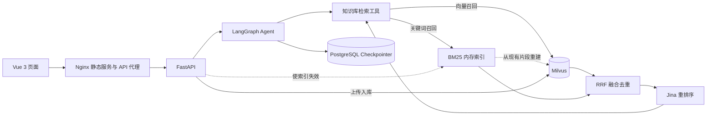

# Starbridge Agentic RAG｜星桥协作企业知识助手

面向模拟 B2B SaaS 产品“星桥协作”的知识库问答项目。它将产品说明、套餐政策、版本公告和客服流程组织成可检索的文档，提供带来源的流式回答、多轮会话和知识文件上传。项目数据为原创模拟内容，不含真实企业或客户数据。

项目覆盖从文档入库、检索与重排序、Agent 调用，到 FastAPI、Vue 页面和 Docker Compose 部署的完整演示链路。

## 功能概览

- **知识入库**：加载 30 份带 YAML 元数据的 Markdown 文档；将文本切分、向量化并写入 Milvus。新环境中的空知识库会在 Compose 启动时初始化。
- **双路检索问答**：LangGraph Agent 根据问题调用知识库工具；并行执行 Milvus 向量召回与 BM25 关键词召回，用 RRF 融合和去重，再由 Jina 重排序。最多返回 5 个参考片段，由 Agent 核对是否足以支持答案；依据不足时澄清或说明信息不足。
- **检索降级**：任一路召回失败时使用另一条路径；重排暂时性网络、限流或服务端错误最多重试一次，仍不可用时保留候选原排序。来源数据区分 COSINE、RRF 与 Jina 分数，不将它们解释为回答准确率。
- **来源追溯**：回答通过 SSE 流式返回，结束后向页面发送文档名、`doc_id`、`chunk_id` 和片段正文。
- **会话管理**：LangGraph Checkpointer 将对话状态保存到 PostgreSQL；前端支持新建、切换、删除会话，并用浏览器本地存储保存会话列表。
- **文件上传**：支持 PDF、TXT、Markdown，单文件最大 10 MB；使用文件 SHA-256 识别重复上传，解析后写入 Milvus。
- **角色隔离**：客户与客服使用不同的知识访问范围和会话命名空间。客服接口请求需要服务端配置的访问令牌。

## 系统结构



| 部分 | 实现 |
| --- | --- |
| 页面 | Vue 3、Vite、Vue Router |
| API | FastAPI、SSE |
| Agent | LangChain、LangGraph、DeepSeek |
| 向量化与检索 | 智谱 Embedding API、Milvus、BM25Okapi、Jieba、RRF、Jina Reranker |
| 会话持久化 | PostgreSQL、LangGraph Checkpointer |
| 部署 | Docker Compose、Nginx |

## 快速启动：Docker Compose

需要 Docker Desktop，以及可用的 DeepSeek、智谱模型服务密钥；建议配置 Jina 密钥以启用重排序。

1. 在项目根目录复制配置文件：

   ```bash
   cp .env.example .env
   ```

2. 编辑 `.env`，至少配置：

   ```env
   DEEPSEEK_API_KEY=你的密钥
   DEEPSEEK_BASE_URL=对应服务地址
   ZHIPUAI_API_KEY=你的密钥
   SUPPORT_ACCESS_TOKEN=自行生成的随机长字符串
   ```

   建议配置有效的 `JINA_API_KEY` 并保持 `RERANK_ENABLED=true`。缺少密钥或重排失败时保留召回候选原排序；可通过 `RERANK_ENABLED=false` 关闭重排。不要提交 `.env`。默认数据库密码仅用于本机演示，部署到其他环境前应修改 `POSTGRES_PASSWORD`。

3. 构建并启动：

   ```bash
   docker compose up -d --build
   docker compose ps
   ```

   Compose 启动 PostgreSQL、Milvus、后端和前端。`knowledge-init` 只在目标 Milvus 集合为空时导入内置文档；已有数据不会被它覆盖。模型 API 需要可用网络连接。

4. 访问：

   | 地址 | 用途 |
   | --- | --- |
   | `http://localhost:5173` | 前端页面；Compose 构建时使用真实 API 模式 |
   | `http://localhost:8000/docs` | FastAPI 接口文档 |
   | `http://localhost:8000/health` | 后端健康检查 |

   宿主机端口可通过 `.env` 中的 `FRONTEND_PORT`、`BACKEND_PORT`、`POSTGRES_PORT` 和 `MILVUS_PORT` 调整。若本机已有服务占用端口，先调整映射，不必停止原有服务。

常用命令：

```bash
docker compose ps               # 查看状态
docker compose logs -f backend  # 查看后端日志
docker compose down             # 停止并移除本项目容器，保留 Volume 数据
```

PostgreSQL、Milvus 和上传文件分别使用 `postgres-data`、`milvus-data`、`uploads-data` 命名 Volume；`docker compose down` 不删除这些数据。

## 本地开发

以下命令均从项目根目录开始。先启动 PostgreSQL 和 Milvus，并在 `.env` 中填写可由本机访问的 `DB_URL`、`MILVUS_URI` 和模型密钥。若通过 Compose 启动了整个项目，且本机 8000 端口已被容器占用，先停止对应服务或改用其他端口。

### 后端

推荐 Python 3.12。使用 Conda 时：

```bash
conda create -n RAG-Agent python=3.12 -y
conda activate RAG-Agent
pip install -r requirements.txt
```

空 Milvus 集合需要初始化内置文档时运行：

```bash
python -m app.bootstrap
```

随后启动 API：

```bash
uvicorn app.main:app --reload
```

`app.bootstrap` 检测到集合已有数据时会跳过，因此它不是“修改内置文档后强制重新索引”的命令。

### 前端

需要 Node.js 和 npm。在 `frontend/` 目录安装依赖：

```bash
cd frontend
npm ci
```

创建 `frontend/.env.local`，让 Vite 开发页面调用本机 API：

```env
VITE_USE_MOCK=false
VITE_API_BASE_URL=http://127.0.0.1:8000
```

然后运行：

```bash
npm run dev
```

不设置 `VITE_USE_MOCK=false` 时，本地开发页面使用 Mock 数据；Compose 构建的页面已配置真实 API。Compose 中的 Nginx 负责提供构建后的 Vue 静态文件，并把 `/api/` 请求代理到后端；本地 `npm run dev` 则由 Vite 提供开发页面。

## 主要接口

| 接口 | 作用 |
| --- | --- |
| `POST /api/chat/stream` | SSE 流式问答；返回 `message`、`sources`、`done` 或 `error` 事件 |
| `POST /api/chat` | 返回完整 JSON 回答，便于接口调试 |
| `POST /api/knowledge/upload` | 上传 PDF、TXT、MD 或 Markdown 文件并入库 |
| `DELETE /api/threads/{thread_id}` | 删除指定角色的会话状态 |

聊天请求示例：

```json
{
  "message": "企业版支持 SSO 吗？",
  "thread_id": "session_demo",
  "role": "customer"
}
```

`role` 默认是 `customer`。`support` 请求还必须提供 `X-Support-Token` 请求头。该令牌只能保存在服务端或受控的内部客户端，不能写进公开的 Vue 页面。

上传接口目前**没有身份认证**；上传文件若未提供 YAML 中的 `audience`，会默认对 `customer` 和 `support` 两种角色可检索。演示时只上传可公开的模拟文档，不要将该接口直接暴露给不受信任的用户。

## 知识库与评测

内置文档位于 `data/knowledge/starbridge-rag-starter/knowledge_base/`：

| 分类 | 文档数 | 内容 |
| --- | ---: | --- |
| `product` | 12 | 产品功能、权限和操作 |
| `support` | 8 | 客服排查与处理流程 |
| `policy` | 6 | 套餐、额度和服务规则 |
| `release` | 4 | 版本公告与历史变化 |

文档的 YAML 头记录 `doc_id`、版本、状态、适用角色等元数据。向量和 BM25 两路均依据 `audience` 限制访问范围；BM25 返回候选前还会查询 Milvus 复核最新权限。当前没有按版本状态或生效日期进行结构化过滤，历史规则仍需由 Agent 根据文档内容判断。

评测题位于 `data/knowledge/starbridge-rag-starter/evaluation/questions.jsonl`，共 60 题，覆盖事实、操作流程、跨文档、历史时效、访问控制和证据不足六类场景。其中 **53 题标注了目标文档**，可计算检索指标。项目分别评估检索排序和完整问答链路，两组数字的口径不同。

### 当前链路：BM25 双路召回与 RRF 融合

默认配置：

```env
BM25_ENABLED=true
BM25_REFRESH_SECONDS=30
RRF_K=60
RERANK_ENABLED=true
RERANK_CANDIDATE_K=20
RERANK_MAX_RETRIES=1
MULTI_QUERY_ENABLED=false
```

- **召回**：Milvus 向量检索与 BM25 关键词检索并发执行，各取最多 20 个片段。BM25 使用 `rank-bm25==0.2.2` 的 BM25Okapi，Jieba 负责中文分词，保留 SSO、CSV、版本号和错误码；按角色分别为标题与正文建立索引。
- **融合**：按片段主键去重，采用 `RRF(d) = sum(1 / (60 + rank_i(d)))` 合并排名，保留 20 个候选。向量距离与 BM25 分数不直接相加。任一路召回失败时继续使用另一条；两路均失败时告知查询服务暂不可用。
- **重排**：以原问题调用 `jina-reranker-v3.5`，返回前 5 个参考片段。超时、连接错误、429 或 5xx 最多重试一次；仍不可用或未配置密钥时保留候选原排序。来源中标明分数类型，Jina 相关性分数不代表回答准确率。
- **上传同步**：Milvus 是唯一持久化数据源，BM25 使用可重建的内存索引，不需要迁移集合或重新向量化。上传完成后使本进程索引失效，下一次检索重建；其他进程最多在 30 秒 TTL 后刷新。关键词候选返回前再次读取 Milvus 元数据，剔除已撤权或删除的片段。
- **回答约束**：检索命中不等于足够回答。Agent 应核对套餐、角色、数字和日期，只回答资料明确支持的部分，依据不足时澄清，忽略文档中的越权指令。前端在回答完成但没有来源时显示友好的空状态。

多 Query 仍是可选功能；启用时原问题和补充查询均走双路召回，融合后执行一次最终重排。现有 30 篇文档与 60 道原题保持不变，便于沿用相同的对照基础。

#### 同题对照评测

```bash
python -m evaluation.compare_hybrid --limit 3
python -m evaluation.compare_hybrid
```

脚本比较“向量＋重排”和“双路 RRF＋重排”，候选预算均为 20、最终输出均为 5。两组复用同一次向量召回；候选顺序完全相同时复用同一次 Jina 请求，否则交替两组请求先后顺序。记录候选召回、Hit@5、Macro Recall@5、MRR、完整目标文档找齐率和服务回退。7 道没有目标文档的题单独观察，不计入检索命中率，也不能仅凭是否返回片段判定回答正确。

Milvus 暂不可用时，可单独运行离线模式：

```bash
python -m evaluation.compare_hybrid --offline
```

离线模式读取内置模拟文档，使用真实智谱 Embedding、内存精确 COSINE、相同 BM25/RRF 代码和真实 Jina API。它不访问或写入 Milvus，**不能代表 Milvus 在线性能或 FastAPI 完整链路验证**。默认不带 `--offline` 时连接现有 Milvus，不创建或清空集合。结果与向量缓存保存在 Git 忽略的 `evaluation/results/`。

2026-11-05 完成上述离线对照：30 篇文档切分为 47 个片段，原题共 60 道，其中 53 道带目标文档。

| 指标 | 向量＋重排 | 双路 RRF＋重排 |
| --- | ---: | ---: |
| Hit@5 | 98.11%（52/53） | **100%（53/53）** |
| Macro Recall@5 | 94.03% | **94.97%** |
| MRR | 0.8931 | 0.8931 |
| 目标文档全部找齐率 | 90.57% | 90.57% |

双路方案补回 Q-048 的目标文档 S-005。向量组 60 次重排均成功；双路组 1 次在重试后回退至 RRF 排序，该题没有目标文档，不影响上述 53 题指标。两组重排均成功的 59 题也得到相同检索指标。结果见 `evaluation/results/hybrid_compare_20261105_offline.json`。

该结果说明关键词召回在当前题集上补回了一个漏检问题，提升幅度有限；小型模拟知识库上的命中率不等于回答准确率，也不能外推到真实企业语料。后续应扩充独立问题与真实文档，并分别验证在线性能和生成答案质量。

实现验证：46 项自动化测试通过，前端构建通过。另使用真实 DeepSeek、Embedding 与 Jina 完成两道进程内 Agent 问答检查：已收录的 SSO/审计日志问题正常回答并返回来源，未收录的 API 限流问题说明信息不足。该检查使用离线语料适配器，不包含 HTTP/SSE、PostgreSQL Checkpointer 或在线 Milvus 验证。

### 向量检索与重排序：同题配对评测

2026-10-02 的本地评测对 53 道有目标文档的题逐题使用**同一次 Embedding、同一批 Milvus 前 20 个候选片段**：一边直接取原排序前 5 条，另一边用 `jina-reranker-v3.5` 重排后取前 5 条。两边使用相同的角色过滤和目标文档标注；这项评测不调用生成回答的模型。

| 指标 | 纯向量排序 | 重排序方案（含失败回退） |
| --- | ---: | ---: |
| Hit@5 | 90.6%（48/53） | **98.1%（52/53）** |
| Macro Recall@5 | 81.5% | **92.5%** |
| MRR | 0.698 | **0.871** |
| 目标文档全部找齐率 | 71.7%（38/53） | **86.8%（46/53）** |
| 平均检索耗时 | 0.27 秒 | 0.84 秒 |

重排序让 4 道原本未命中的题进入前五；平均每题多用约 0.57 秒。**53 次中有 47 次实际完成 Jina 重排，6 次因外部服务请求失败而回退到 Milvus 原排序**，因此右列衡量的是当前“重排＋回退”实现的实际效果，不代表 Jina 53 次全部成功。检索耗时不包含 Agent 生成答案的时间。

从项目根目录复现：

```bash
RERANK_CANDIDATE_K=20 python -m evaluation.compare_retrieval
```

该脚本只读取当前 Milvus 集合，不改写向量；运行需要有效的 `ZHIPUAI_API_KEY`、`JINA_API_KEY` 和 `MILVUS_URI`。为防止把上传资料发往外部服务，脚本仅接受本项目标记为 `source: synthetic` 的内置模拟文档，遇到其他来源会停止。报告包含题集校验值、候选数、逐题文档编号和回退题号，保存到被 Git 忽略的 `evaluation/results/`。

### 可选：多 Query 扩展

默认保持 `MULTI_QUERY_ENABLED=false`。以下结果为历史纯向量扩展实验；当前启用后，每次知识库工具调用会保留原问题，使用 DeepSeek 生成最多两个补充查询（简单问题可以不扩展）。每路均按同一服务端角色过滤，按片段主键去重、用 RRF 融合排名，融合后仍只保留 20 个候选，再以原问题调用 Jina 重排序并选取前 5 条。查询扩展不改变模型自行决定是否调用知识库工具的方式。

扩展请求失败或 JSON 不合法时保留原检索结果；某一路补充检索失败时保留其余结果。此功能只改变查询流程，不需要重新向量化或修改 Milvus 集合。额外的模型请求和检索会增加延迟与 API 用量。

在 `.env` 中配置并重启后端后生效：

```env
MULTI_QUERY_ENABLED=true
MULTI_QUERY_MODEL=deepseek-v4-flash
MULTI_QUERY_TIMEOUT=10
```

用原有题集对比单 Query 与多 Query（不受启用开关影响，脚本始终计算两种方案）：

```bash
python -m evaluation.compare_multi_query --limit 3  # 先试跑
python -m evaluation.compare_multi_query            # 53 道有目标文档的题
```

两路复用同一次原问题检索，候选预算均为 20、最终输出均为 5 个片段；扩展后的补充检索最多两路并发。报告记录候选集目标文档召回、最终 Hit@5 / Recall@5 / MRR、完整目标文档找齐率、耗时、扩展 Token 用量和失败题号，并单列两边 Jina 均成功的子集，以识别外部服务失败对结果的影响。脚本只读现有 Milvus，发送给外部重排序服务的候选必须来自内置模拟知识库。结果保存在 `evaluation/results/multi_query_compare_*.json`，不会提交到 Git。

2026-11-04 使用原有 53 道有目标文档的题完成真实对照（Milvus 共 47 个片段，均使用 Jina，含失败回退）：

| 指标 | 单 Query + Jina | 多 Query + Jina |
| --- | ---: | ---: |
| Hit@5 | 98.11% | 100.00% |
| Macro Recall@5 | 93.08% | 92.77% |
| MRR | 0.8459 | 0.9308 |
| 目标文档全部找齐率 | 88.68% | 86.79% |
| 20 个候选片段中的目标文档平均召回率 | 96.54% | 98.43% |
| 平均检索总耗时（含扩展和重排，不含答案生成） | 3.70 秒 | 5.35 秒 |

两路均有 43/53 次 Jina 请求成功，各有 10 次超时回退，但失败题号不同。两边 Jina 均成功的 37 题中，单 Query / 多 Query 的 Hit@5 为 97.30% / 100%，Macro Recall@5 为 94.59% / 97.30%，目标文档全部找齐率为 91.89% / 94.59%，MRR 为 0.8739 / 0.9324。这个子集帮助观察正常重排时的差异，不能代替完整题集结果。

多 Query 确实找回了 Q-048 的目标文档 S-005，原查询的 20 个候选里没有该文档；Q-024、Q-060 则在多 Query 一侧重排超时后出现文档找齐率下降。整个实验有 41 题实际扩展、8 题不扩展、4 题因扩展响应 JSON 不合法而回退，补充检索共 80 次且均成功。扩展模型报告用量为 9,310 个输入 Token、9,123 个输出 Token。

**当前保持默认关闭。** 本次实验表明它能补足个别漏召回，但全量 Recall 和找齐率没有提升，平均每题多约 1.65 秒；不能仅凭 Hit@5 达到 100% 就宣称整体问答质量提升。题目仍是小规模自建集，以上均为检索指标，不是回答准确率。此处使用同次运行的单 Query 作为基线，不与 10 月 2 日的旧报告直接相减。完整逐题记录在 `evaluation/results/multi_query_compare_20261104.json`。

### 完整问答链路

另一份[端到端评测程序](evaluation/evaluate.py)调用真实 SSE 接口，记录回答、来源与响应时间：

```bash
python evaluation/evaluate.py --limit 5  # 先检查链路
python evaluation/evaluate.py            # 运行全部 60 题
```

最近一次本地完整运行（2026-10-01）中，60/60 题成功返回；53 道有目标文档的题上，来源 Hit@5 为 **96.2%**、Macro Recall@5 为 **90.9%**、MRR 为 **0.841**，平均完整响应时间 **4.38 秒**。Agent 可能多次调用工具，因此这些来源指标不能与上面的单次检索配对评测直接相减。

上述两类检索指标都**不是回答准确率**：Hit@5 只要求前五个来源至少命中一份目标文档。回答是否符合 `expected_behavior` 和 `expected_points`，以及权限拒答、日期判断是否正确，仍需逐题人工检查。题集由项目自行构建，结果不代表生产环境表现。

## 项目目录

```text
.
├── app/
│   ├── api/                # 聊天、上传、会话接口
│   ├── agent/              # Agent、提示词与检索工具
│   ├── RAG/                # 文档加载、切分、检索、重排序、写入
│   ├── bootstrap.py        # 空集合初始化
│   └── main.py             # FastAPI 入口
├── data/knowledge/         # 内置知识库与评测题
├── evaluation/evaluate.py  # 端到端评测程序
├── frontend/               # Vue 页面与 Nginx 配置
├── tests/                  # 访问边界相关测试
├── compose.yaml
├── Dockerfile
├── requirements.txt
└── .env.example
```

## 当前边界

- 项目使用客服共享令牌区分两种角色，尚未实现用户登录、按组织和项目授权的完整权限体系。
- 知识上传尚未加入身份认证、审核或文档发布流程；上传内容会直接进入向量库。
- 文档版本、状态和生效日期未作为结构化检索条件；冲突或时效问题需要进一步人工核验。
- 自动化测试覆盖角色访问边界、多 Query、BM25 索引刷新、上传失效通知、双路降级及重排异常回退；尚未覆盖生产并发压力与完整部署测试。
- BM25 内存索引适合当前小规模知识库；每个后端进程各保留一份索引，定期全量重建，大语料需改用专用全文索引或 Milvus 内置稀疏检索。
- Jina 服务失败时使用候选原排序，排序质量可能下降；检索命中不等于回答正确，仍需对生成答案做独立评测。

本项目用于展示企业知识库的数据组织、检索问答和可复现部署流程，当前定位是可运行的作品集项目。
